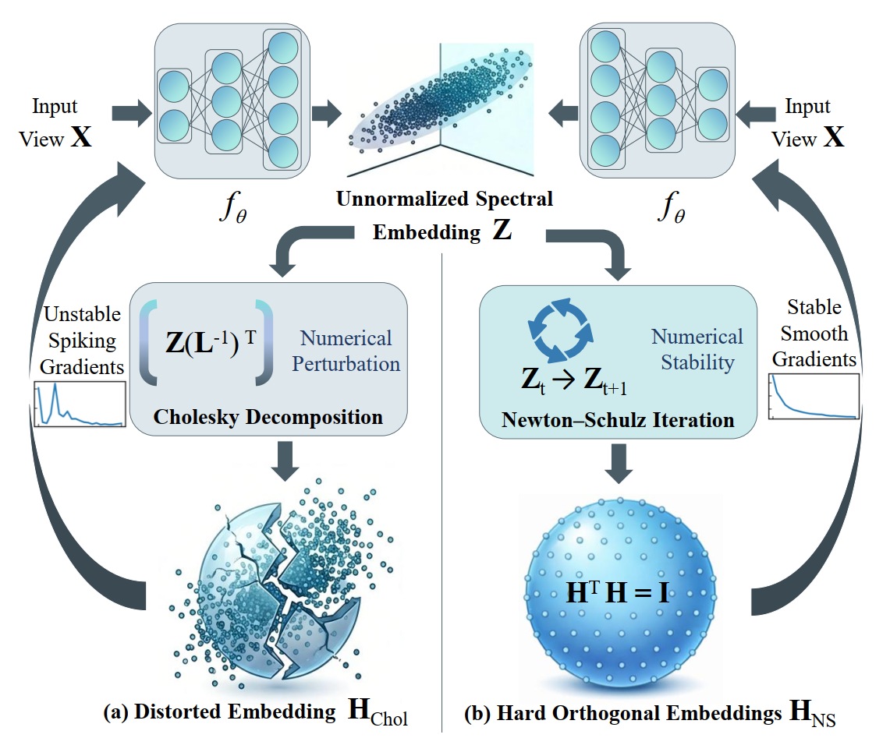

# MSCL: Multi-View Spectral Contrastive Learning

PyTorch implementation of **Multi-View Spectral Contrastive Learning** (IEEE TPAMI 2026).

MSCL unifies contrastive learning and spectral clustering from a spectral-operator perspective. It jointly optimizes multiple view-specific spectral embeddings and a consensus spectral embedding, enabling principled multi-view spectral fusion in an end-to-end framework.



## Requirements

```bash
python>=3.9.21
pytorch>=2.5.1
numpy>=2.0.2
scikit-learn>=1.6.0
scipy>=1.13.1
```

## Data and Config

Prepare datasets following `dataprocessing.py`, and set dataset-specific hyperparameters such as `dims`, `alpha`, `beta`, and `knn` in:

```text
config/{db}.yaml
```

Results are appended to:

```text
results/res_{db}.txt
```

Please make sure the `results` directory exists.

## Quick Start

```bash
# MNIST-USPS
python main.py --db MNIST_USPS --kernel cosine --gpu 0

# 3Sources
python main.py --db 3Sources --kernel cosine --gpu 0

# BBCSport
python main.py --db BBCSport --kernel cosine --gpu 0
```

## Code Structure

```text
.
├── main.py              # Training and evaluation entry
├── layers.py            # Model, Newton-Schulz orthogonalization, kernels
├── utils.py             # Graph construction and utilities
├── metrics.py           # Clustering metrics
├── dataprocessing.py    # Multi-view data loading
├── config/              # Dataset configs
└── results/             # Output results
```

## Citation

If you find this work useful, please cite:

```bibtex
@article{cai2026multi,
  title={Multi-View Spectral Contrastive Learning},
  author={Cai, Bing and Wang, Xiaoli and Lu, Gui-Fu and Li, Zechao},
  journal={IEEE Transactions on Pattern Analysis and Machine Intelligence},
  year={2026},
  publisher={IEEE}
}
```
